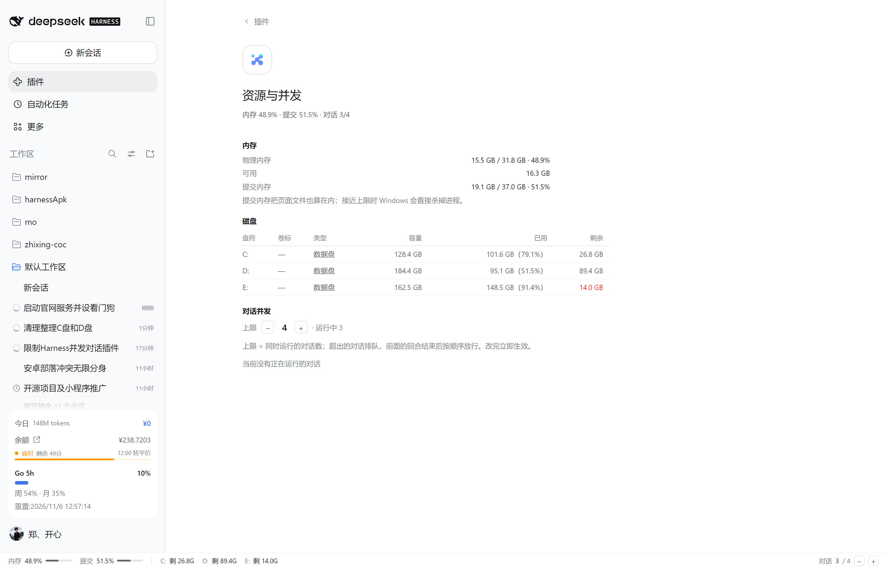

# dsh-conversation-queue

[中文](README.md)

A concurrency gate for [DeepSeek Harness](https://github.com/deepseek-ai): **cap how many conversations may run at once**, let the rest wait in FIFO order until an earlier turn finishes, and show a memory / commit / disk status strip at the bottom of the web UI.

Built for 32 GB machines where two concurrent conversations are enough to get the host killed by Windows. Instead of running conversation #3 and #4 at the same time, they wait silently — no model call, no context assembly, almost no memory.


## Features

- **Conversation-level concurrency limit** — a conversation beyond the cap parks right before its request is sent and is released in FIFO order when an earlier turn ends.
- **Bottom strip** (`shell.bottom`): physical memory, commit memory, free space per fixed drive, running / queued counts, current limit.
- **Hover details**: on a drive letter, what the drive is (system / data), its volume label, file system, capacity, used and free space, plus why a tight system drive makes OOM kills more likely; on the conversation counter, every running and queued session with its title and elapsed / waiting time.
- **Settings page**: Plugins → **资源与并发**, the same data laid out as tables, with `−` / `+` to change the limit.
- **Runtime tuning**: edit one JSON file, effective within 1.5 s — no YAML edit, no restart.
- **Root conversations only**: subagents / background jobs are never queued (otherwise a parent waits for its child while the child waits for a slot — deadlock).

## Install

From GitHub (no npm publish needed):

```powershell
& '<DSH install dir>\resources\runtime\cli\bin\dsh.cmd' plugin --profile web add github:zhengkaixing/dsh-conversation-queue
```

Restart DSH once afterwards: the client bundle and HTTP routes are mounted at startup.

From the plugin market / npm:

```powershell
& '<DSH install dir>\resources\runtime\cli\bin\dsh.cmd' plugin --profile web add dsh-conversation-queue
```

Local development:

```powershell
& '<DSH install dir>\resources\runtime\cli\bin\dsh.cmd' plugin --profile web add 'link:C:/path/to/dsh-conversation-queue'
```

`dsh plugin add` writes the package into the profile `package.json`, appends it to `dsh.profile.bundles` and runs pnpm. Plugin code changes require a restart (HMR reloads configuration only).

## UI

### Bottom strip

```
内存 60% ▓▓▓░░   提交 89% ▓▓▓▓▓   C: 剩 24.0G   D: 剩 89.4G   E: 剩 14.0G        对话 2 / 3 · 排队 1   −  +
```

- Polls `GET /dsh-resource/status` every 3 s; same origin, no extra port.
- `≥80%` turns amber, `≥88%` turns red. **Commit memory** is the metric to watch: it includes the page file, and Windows kills processes when it approaches the limit.
- `−` / `+` change the cap immediately (writes the settings file, effective within 1.5 s).

| Hover a drive | Hover the conversation counter |
| --- | --- |
|  |  |

### Settings page

Sidebar → **Plugins** → **资源与并发**: memory, disks and conversation concurrency, with `−` `+`.



## Configuration

```yaml
- insert:
    - id: conversation-queue
      name: 'dsh-conversation-queue'
      config:
        enabled: true        # master switch
        maxConcurrent: 2     # conversations allowed to run at once (2 for 32 GB, 1 when tight)
        queueSubagents: false
        statusFile: ''       # empty = $DSH_HOME/conversation-queue.json
        settingsFile: ''     # empty = $DSH_HOME/conversation-queue.settings.json
        logAdmissions: true
```

Override in `~/.dsh/profiles/web/cordis.patch.yml` with the same id if you prefer:

```yaml
- id: conversation-queue
  config:
    maxConcurrent: 3
```

## Runtime limit (no restart)

```json
// %USERPROFILE%\.dsh\conversation-queue.settings.json
{ "maxConcurrent": 3, "source": "dsh-ui" }
```

- Writable fields: `maxConcurrent` (integer 1–8) and `enabled`. Omitted fields fall back to the YAML config; deleting or emptying the file does the same.
- Invalid JSON or `maxConcurrent: 0` is ignored, keeping the current limit.
- Three entry points: the strip buttons, the settings page buttons, or this file.

## Host API

| Method | Path | Notes |
| --- | --- | --- |
| GET | `/dsh-resource/status` | `{ ok, time, platform, memory, disks, gate }` |
| POST | `/dsh-resource/limit` | body `{ "maxConcurrent": 3 }`, optional `{ "enabled": false }`; 400 on invalid input |

`memory` = `{ totalBytes, availBytes, usedBytes, usedPercent, commitLimitBytes, commitUsedBytes, commitPercent, load, sampler }`;
`disks[]` = `{ name, label, fileSystem, system, totalBytes, freeBytes, usedBytes, usedPercent }`;
`gate` = `{ enabled, maxConcurrent, running, waiting, active: [{ id, title, turn, runningMs }], queue: [{ id, title, position, waitingMs }] }`.

Both routes go through the host's own HTTP server and inherit its auth (same-origin only).
`memory.sampler` is `ok` / `starting` / `error: …`: commit memory comes from a long-lived PowerShell sampler (Node has no `process.getSystemMemoryInfo` under `ELECTRON_RUN_AS_NODE`), so it needs 1–2 s after startup.

## Status and troubleshooting

```powershell
Get-Content "$env:USERPROFILE\.dsh\conversation-queue.json"
```

- `maxConcurrent` / `enabled` are the **effective** values; `configured` holds the YAML defaults.
- `lastEvent: "unloaded"` means the plugin was unloaded or failed to reload.
- `$env:USERPROFILE\.dsh\conversation-queue.boot.log` records whether the plugin loaded (`import` without `apply-ok` means load failure, with `apply-failed` and a stack).
- Search the host log for `conversation-queue:` to see every admission / release / queue decision.

## Known behavior

- A queued conversation still looks "running" in the UI (its turn started, it just hasn't sent a request); the strip and the settings page show the real queued state.
- Stopping / closing a queued conversation drops it from the queue immediately; closing a running one hands the slot to the next waiter at once.
- Unloading the plugin rejects or releases every waiter; no conversation is left waiting forever.
- The limit is constrained to 1–8.

## Development

```powershell
node test.mjs
node ..\..\_scratch\dsh-queue\rig\integration.mjs
node ..\..\_scratch\dsh-queue\rig\settings.mjs
node ..\..\_scratch\dsh-queue\rig\routes.mjs
node ..\..\_scratch\dsh-queue\rig\client-load.mjs
node ..\..\_scratch\dsh-queue\rig\client-dom.mjs
```

## License

[MIT](LICENSE)
