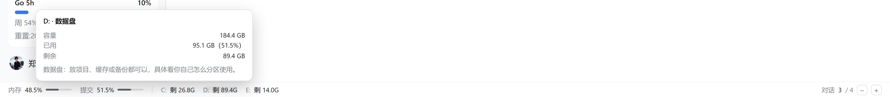
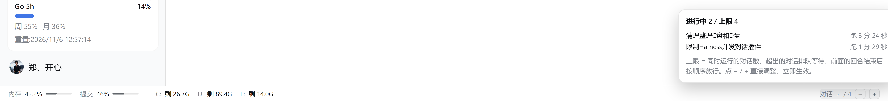
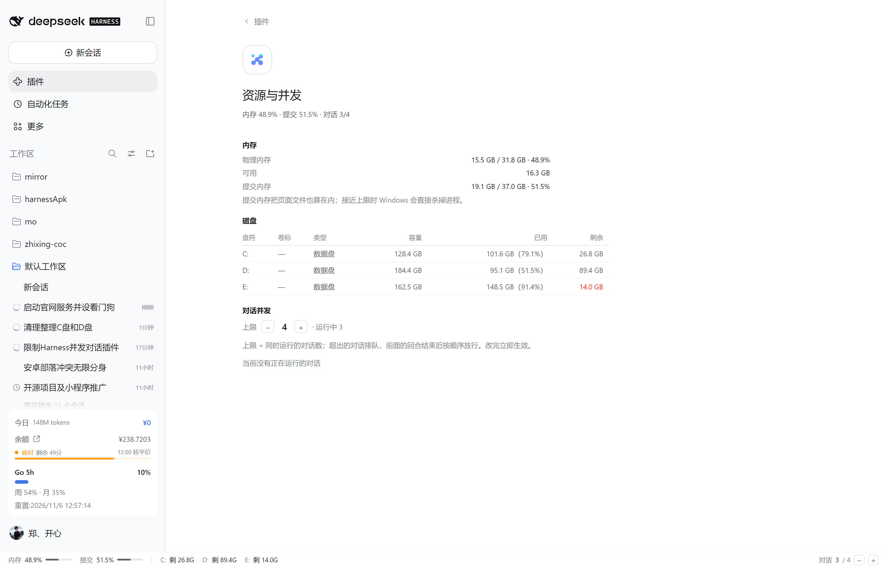

# dsh-conversation-queue

[English](README.en.md)

给 [DeepSeek Harness](https://github.com/deepseek-ai) 用的并发闸门：**限制同时运行的对话数量**，超出的对话先来后到排队，等前面的回合结束后自动放行；顺手在界面底部挂一条内存 / 提交内存 / 磁盘状态条。

为 32G 内存这类“两个对话一起跑就可能被系统 kill”的机器设计。不再让第 3、第 4 个对话同时发请求，而是让它们静默排队——排队时既不调模型、也不组装上下文，几乎不占内存。


## 功能

- **对话级并发限制**：到上限的对话停在“发请求之前”，前面的回合结束后按 FIFO 自动放行。
- **底部状态条**（`shell.bottom`）：内存、提交内存、每块固定盘剩余、运行中 / 排队数、当前上限。
- **悬浮解释**：鼠标停在盘符上，能看到它是什么盘（系统盘 / 数据盘）、卷标、文件系统、容量、已用、剩余，以及“为什么系统盘空间紧张会连带杀进程”的说明；停在“对话”上能看到正在跑 / 排队的每一个会话标题和已跑 / 已等时长。
- **设置页**：Plugins → **资源与并发**，同一份数据摊开成表格，并可直接 `−` / `+` 调整上限。
- **运行期调参**：改一个 JSON 文件 1.5 秒内生效，不用改 YAML、不用重启。
- **仅限制根对话**：子代理 / 后台任务不排队（否则父对话等子代理、子代理等槽位会死锁）。

## 安装

### 从 GitHub 直接安装（推荐，不需要发 npm）

```powershell
& '<DSH 安装目录>\resources\runtime\cli\bin\dsh.cmd' plugin --profile web add github:zhengkaixing/dsh-conversation-queue
```

装完重启一次 DSH（新增的浏览器端 bundle 与 HTTP 路由都是启动时挂载的）。

### 从插件市场 / npm

```powershell
& '<DSH 安装目录>\resources\runtime\cli\bin\dsh.cmd' plugin --profile web add dsh-conversation-queue
```

### 本地开发（link）

```powershell
& '<DSH 安装目录>\resources\runtime\cli\bin\dsh.cmd' plugin --profile web add 'link:C:/path/to/dsh-conversation-queue'
```

`dsh plugin add` 会把这个包写进 profile 的 `package.json`、追加到 `dsh.profile.bundles` 并跑一次 pnpm。
改完插件代码需要重启 DSH 才会生效（HMR 只重载配置，不重载插件代码）。

## 界面

### 底部状态条

```
内存 60% ▓▓▓░░   提交 89% ▓▓▓▓▓   C: 剩 24.0G   D: 剩 89.4G   E: 剩 14.0G        对话 2 / 3 · 排队 1   −  +
```

- 每 3 秒轮询一次 `GET /dsh-resource/status`，同源、不额外开端口。
- `≥80%` 显示琥珀色，`≥88%` 显示红色。“提交内存”是最该盯的指标：它把页面文件算在内，接近上限时 Windows 会直接杀进程。
- 点 `−` / `+` 立刻改并发上限（写 settings，1.5 秒内生效）。

| 悬浮在盘符上 | 悬浮在“对话”上 |
| --- | --- |
|  |  |

### 设置页

Sidebar → **Plugins** → **资源与并发**：内存 / 磁盘 / 对话并发三段，带表格和 `−` `+`。



## 配置

配置写在插件自带的 `cordis.patch.yml` 里：

```yaml
- insert:
    - id: conversation-queue
      name: 'dsh-conversation-queue'
      config:
        enabled: true        # 总开关，false = 完全不限制
        maxConcurrent: 2     # 同时允许运行的对话数；32G 内存建议 2，紧张就 1
        queueSubagents: false
        statusFile: ''       # 留空 = $DSH_HOME/conversation-queue.json
        settingsFile: ''     # 留空 = $DSH_HOME/conversation-queue.settings.json
        logAdmissions: true  # 每次放行 / 排队是否写日志
```

也可以在 `~/.dsh/profiles/web/cordis.patch.yml` 里用同一个 id 覆盖（建议把需要的字段写全）：

```yaml
- id: conversation-queue
  config:
    maxConcurrent: 3
```

## 运行期调整上限（不用重启）

```json
// %USERPROFILE%\.dsh\conversation-queue.settings.json
{ "maxConcurrent": 3, "source": "dsh-ui" }
```

- 可写字段只有 `maxConcurrent`（1~8 的整数）和 `enabled`；没写的字段沿用配置默认值，文件删掉或清空也回到默认值。
- 非法 JSON / `maxConcurrent: 0` 会被忽略并保持当前上限（避免手滑把上限打回 1 或半写入导致乱跳）。
- 三个入口：底部状态条的 `−` `+`、设置页的 `−` `+`、直接编辑这个文件。

## 宿主接口

| 方法 | 路径 | 说明 |
| --- | --- | --- |
| GET | `/dsh-resource/status` | `{ ok, time, platform, memory, disks, gate }` |
| POST | `/dsh-resource/limit` | body `{ "maxConcurrent": 3 }`，可选 `{ "enabled": false }`；非法值 400 |

`memory` = `{ totalBytes, availBytes, usedBytes, usedPercent, commitLimitBytes, commitUsedBytes, commitPercent, load, sampler }`；
`disks[]` = `{ name, label, fileSystem, system, totalBytes, freeBytes, usedBytes, usedPercent }`；
`gate` = `{ enabled, maxConcurrent, running, waiting, active: [{ id, title, turn, runningMs }], queue: [{ id, title, position, waitingMs }] }`。

两个接口都经由宿主自己的 HTTP 服务，沿用它的鉴权（同源可用）。
`memory.sampler` 是 `ok` / `starting` / `error: …`：提交内存靠一个常驻 PowerShell 采样进程提供（`ELECTRON_RUN_AS_NODE` 下 Node 拿不到 `process.getSystemMemoryInfo`），启动后 1~2 秒才有值。

## 查看状态与排障

```powershell
Get-Content "$env:USERPROFILE\.dsh\conversation-queue.json"
```

```json
{
  "running": 2,
  "waiting": 1,
  "maxConcurrent": 2,
  "enabled": true,
  "configured": { "enabled": true, "maxConcurrent": 2 },
  "active": [{ "id": "session-...", "title": "整理插件文档", "turn": 3, "runningMs": 12480 }],
  "queue": [{ "position": 1, "id": "session-...", "title": "重构设置页", "turn": 1, "waitingMs": 5300 }],
  "totals": { "admitted": 12, "queued": 5 },
  "lastEvent": "loaded"
}
```

- `maxConcurrent` / `enabled` 是**当前生效值**，`configured` 是 YAML 默认值。
- `lastEvent` 变成 `unloaded` 说明插件已卸载或重载失败。
- `$env:USERPROFILE\.dsh\conversation-queue.boot.log` 记录插件是否被加载（只有 `import` 没有 `apply-ok` 就是加载失败，会带 `apply-failed` 和堆栈）。
- 宿主日志里搜 `conversation-queue:` 能看到每次放行 / 释放 / 排队。

## 已知行为

- 排队中的对话在界面上仍显示“运行中”（回合已经开始，只是卡在发请求之前）；状态条和设置页会如实显示“排队”。
- 排队中停止 / 关闭对话会立刻退出队列；正在运行的对话被关闭时槽位立即转给下一位。
- 插件卸载时所有排队者被拒绝/放行，不会留下永远等不到的对话。
- 上限的调整范围是 1~8；再大的值对个人机器没有意义。

## 开发与测试

```powershell
node test.mjs                        # 13 项单元检查
node ..\..\_scratch\dsh-queue\rig\integration.mjs   # 11 项（真实 cordis 4.0.5 派发）
node ..\..\_scratch\dsh-queue\rig\settings.mjs      # 10 项（运行期改上限）
node ..\..\_scratch\dsh-queue\rig\routes.mjs        # 36 项（HTTP 接口 / 晚就绪注册 / 卸载回收）
node ..\..\_scratch\dsh-queue\rig\client-load.mjs   # 17 项（浏览器模块契约）
node ..\..\_scratch\dsh-queue\rig\client-dom.mjs    # 27 项（jsdom 真挂载、点击、失败态）
```

`rig` 里用 `react` / `jsdom` 以及从 `app.asar` 抽出来的 `@deepseek-ai/cordis`、`@deepseek-ai/cosmokit`（`file:` 依赖）。

## License

[MIT](LICENSE)
